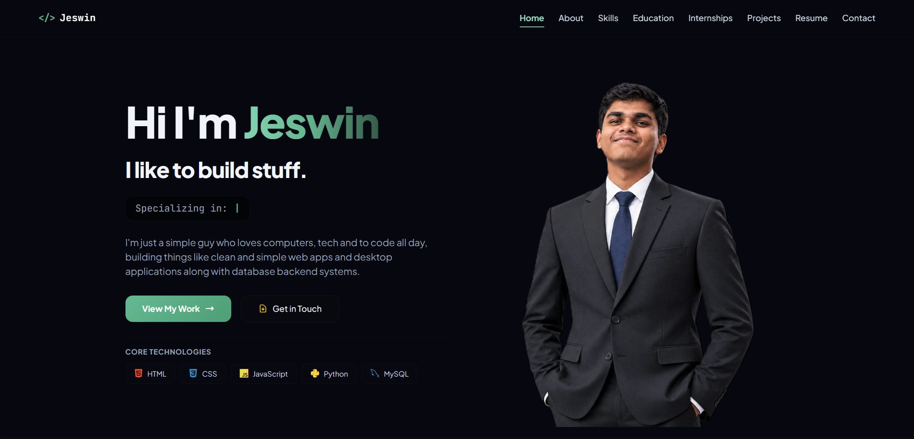
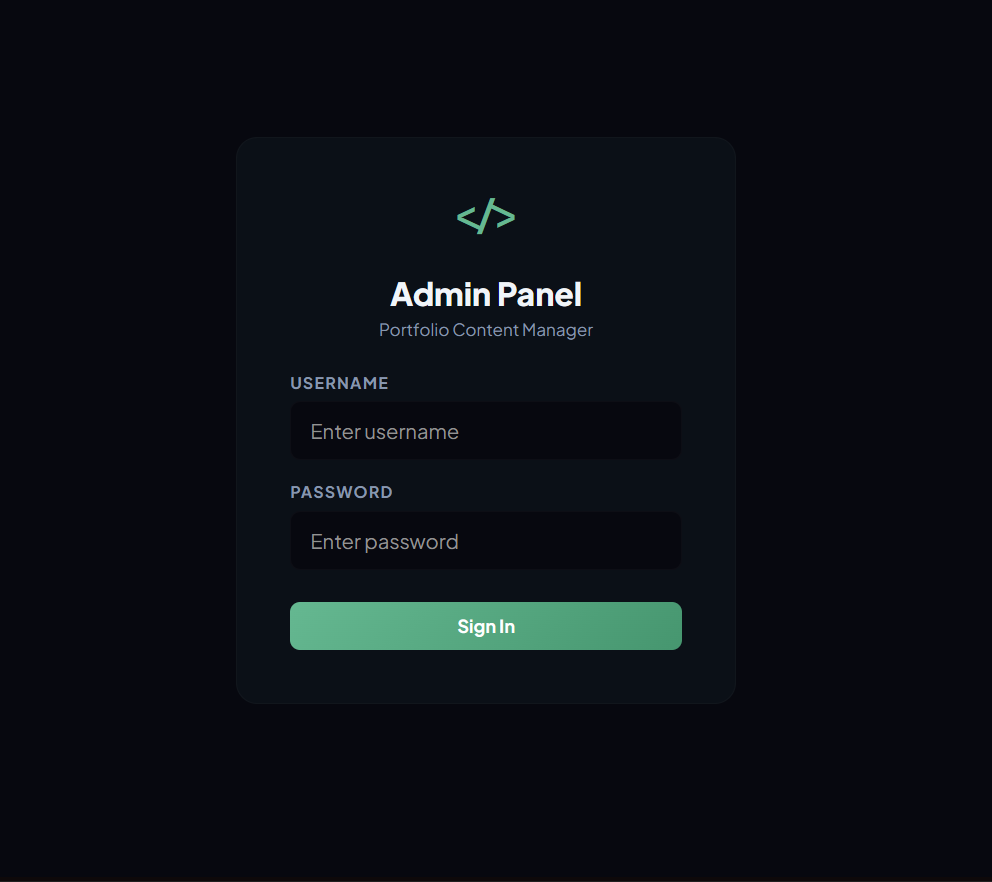

# Jeswin's Portfolio

A dark, single-page developer portfolio with a built-in admin panel, so the content can be edited from the browser without touching the code.



## Highlights

- **One page, eight sections:** Home, About, Skills, Education, Internships, Projects, Resume and Contact.
- **Projects** shown inside browser and desktop-window frames, with links to the code on GitHub.
- **Resume** can be previewed or downloaded from the page.
- **No build step and no framework:** plain HTML, Tailwind CSS (via CDN) and vanilla JavaScript.
- **Admin panel** to edit texts, theme and fonts, social links, images and the resume, then save straight into the site files.

## Admin panel

`admin.html` is a content manager for the portfolio. It runs entirely in the browser and reads and writes your local files through the File System Access API.



| Tab            | What you can change                                                            |
| -------------- | ------------------------------------------------------------------------------ |
| Edit Texts     | Hero, about, education, internships, projects, contact and footer text         |
| Theme & Colors | Brand colours, gradient headings, glow effects, background, font and base size |
| Social Links   | GitHub, LinkedIn, Twitter, Instagram and email                                 |
| Images         | Hero photo (with size control) and the two project screenshots                 |
| Resume         | Upload a new PDF and preview it                                                |
| Accounts       | Turn login on or off and manage admin accounts                                 |

### Using it

1. Open `admin.html` in **Chrome or Edge**. Firefox and Safari don't support the File System Access API.
2. Click **Select Folder** and choose this project folder.
3. Make your edits and press **Save**. Changes are written into `portfolio.html`, and uploaded images and the resume are saved into the folder.

> The sign-in screen is a convenience, not real security: the page runs locally and anyone with the files can open it. Don't reuse a password you care about.

## Project structure

```
.
├── portfolio.html    the site
├── admin.html        the admin panel
├── Screenshots/      images used by the site: me.png, project1.png, project2.png
└── Documents/        my resume.pdf (linked from the site) and the screenshots used in this README
```

## Run locally

There is nothing to install. Open `portfolio.html` in a browser, or use the **Live Server** extension in VS Code.

Image paths are case-sensitive on most hosts, so keep the folder name `Screenshots/` exactly as written.

## Tech

HTML · Tailwind CSS · JavaScript · Devicon · Google Fonts (Plus Jakarta Sans, JetBrains Mono)

## Contact

Find the links to GitHub, LinkedIn and email in the Contact section of the site.
